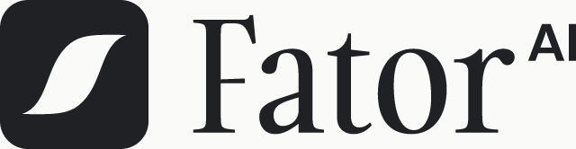
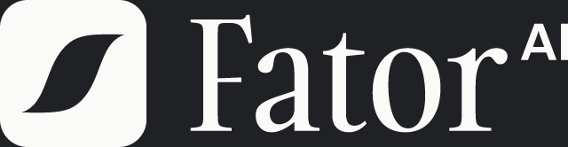
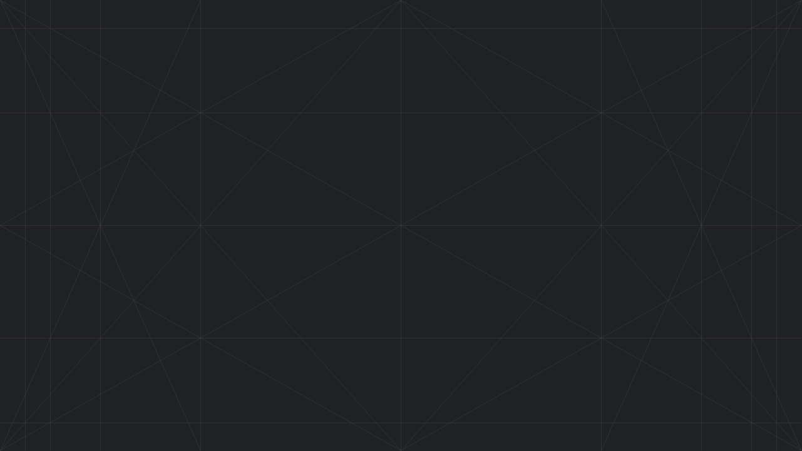

# Fator AI · Brand Kit

Implementação de IA para empresas brasileiras. 
Identidade visual oficial: logos, cores, tipografia, malha e guia de uso.

Os assets e os tokens deste repositório vêm do código da landing page (`fator.ai.lp`),
que é a fonte de verdade. Este repositório também é uma skill para agentes de IA: a porta
de entrada é o [SKILL.md](SKILL.md), que carrega as regras completas da identidade.

 

## Logo

| Versão | Logo completo | Símbolo |
|--------|---------------|---------|
| **Principal** (fundos claros) | 
 [svg](logo/fator-logo-light.svg) / [png](logo/fator-logo-light.png)
 | 
 [svg](logo/fator-icon-light.svg) / [png](logo/fator-icon-light.png)
 |
| **Invertida** (fundos escuros) | 
 [svg](logo/fator-logo-dark.svg) / [png](logo/fator-logo-dark.png)
 | 
 [svg](logo/fator-icon-dark.svg) / [png](logo/fator-icon-dark.png)
 |
| **Favicon** (só para ícone de site e avatar) | | 
 [svg](logo/favicon.svg) / [png](logo/favicon.png)
 |

Para HTML e código, use as versões em `currentColor`, que aceitam qualquer uma das duas tintas:
[fator-logo.svg](logo/fator-logo.svg) e [fator-icon.svg](logo/fator-icon.svg).

➡️ Uso

- Fundos aprovados: papel (padrão), grafite (capa e fechamento) e ciano (destaque). Logo grafite sobre papel e ciano; logo papel sobre grafite.
- O logo completo é o padrão. O símbolo sozinho é para avatar, favicon e assinatura.
- Área de respiro: metade da altura do símbolo, em todos os lados.
- Tamanho mínimo: símbolo com 24px de altura, logo completo com 96px de largura.
- Não recolorir além das duas tintas, não inclinar, não aplicar sombra, não redesenhar o símbolo e não reescrever a palavra em outra fonte.

 

## Paleta

Grafite e papel são a marca; todo o resto é apoio. Um só destaque ciano por peça.

| Cor | Amostra | Hex | Uso |
|-----|---------|-----|-----|
| Grafite |  | `#202125` | Fundo escuro, texto sobre claro, bordas |
| Ciano de traço |  | `#1ac3d8` | Traços, etiquetas, links e acentos sobre fundo claro; favicon |
| Ciano de chip |  | `#a9dde2` | Chip de seção quando o fundo é ciano |
| Ciano |  | `#bcf7fd` | O destaque: um card, uma linha, um trecho. Acentos sobre grafite |
| Ciano lavado |  | `#ecf9f9` | Hachura de diagrama, linha selecionada |
| Cinza |  | `#f2f2f2` web · `#e9e9e8` deck | Chip sobre papel, painel neutro |
| Papel |  | `#fafaf8` | Fundo padrão, texto sobre grafite |

Para usar em código: [colors/tokens.css](colors/tokens.css) (copiado direto da landing page)
e [colors/tokens.json](colors/tokens.json), que traz os nomes das variáveis usados no código
e no Figma, com notas de uso.

 

## Tipografia

| Fonte | Pesos | Uso | Download |
|-------|-------|-----|----------|
| **Switzer** | Regular 400, Medium 500 | Tudo que se lê: títulos, corpo de texto, números, legendas | [Fontshare ↗️](https://www.fontshare.com/fonts/switzer) |
| **Space Grotesk** | Medium 500 | Etiquetas em caixa alta: chips de seção, labels, cabeçalhos de tabela, botões | [Google Fonts ↗️](https://fonts.google.com/specimen/Space+Grotesk) |
| **Gambarino** | | Vive apenas dentro do logo. Nunca em título ou texto | [Fontshare ↗️](https://www.fontshare.com/fonts/gambarino) |

- Nunca acima de Medium 500: a marca não usa bold.
- Na web, carregue pelos links oficiais (Fontshare e Google Fonts). Em arquivos que precisam funcionar offline, como um PDF ou um HTML encaminhado, use o CSS com as fontes embutidas que fica no repositório interno de skills do time (ver [typography/](typography/)).

 

## Malha

A textura de grade da marca, usada em capas, fechamentos e na og-image.

- [malha-1280x720.svg](illustrations/malha-1280x720.svg) para tela.
- [malha-1280x720-print.svg](illustrations/malha-1280x720-print.svg) para qualquer coisa que vira PDF: é a versão achatada, que evita o véu cinza que a versão de tela produz na impressão.
- [social-media-cover/og-image.png](social-media-cover/og-image.png) é a imagem de compartilhamento do site (1040 x 560).

 

## Templates e guia completo

- [templates/deck.html](templates/deck.html): deck 1280 x 720 pronto para clonar, com fontes embutidas, malha e logo já posicionados.
- Os materiais comerciais (R1, R2 e proposta) vivem no repositório interno de skills do time e não devem ser reconstruídos do zero.
- [SKILL.md](SKILL.md) carrega as regras completas; a pasta [references/](references/) detalha cada mídia (deck, web, social, documentos, Figma).
- [scripts/brand-check.sh](scripts/brand-check.sh) verifica um arquivo ou pasta contra a identidade: paletas aposentadas, pesos bold, sombras, cores fora da rampa, vocabulário banido.

 

## As cinco regras de ouro

1. **Grafite e papel fazem o trabalho.** `#202125` e `#fafaf8` são a marca; o resto é apoio.
2. **Um destaque ciano por peça.** O ciano marca a resposta certa; dois destaques se anulam.
3. **Switzer diz, Space Grotesk etiqueta.** Nunca acima de Medium 500.
4. **Flat, desenhado, quase quadrado.** Linhas de 1 a 2px, cantos de 2 a 3px, sem sombra, sem gradiente.
5. **Todo número cita a fonte**, sempre, logo abaixo do número.
